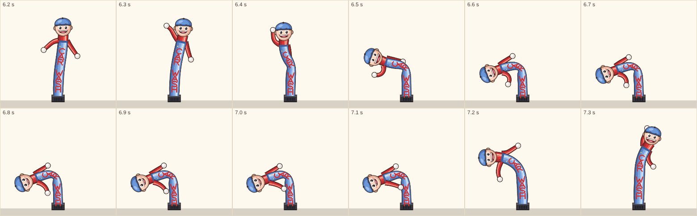

# Fuel, the workshop and the car wash — what exists, 2026-10-12

Marcus, 2026-10-11: "part of the driving game, as the levels go on, will also
involve tanking fuel at one of the two local garages, and sometimes a visit to
the workshop for repairs, and also visiting the car wash with the inflatable
guy (which needs better animated artwork)". The rules are being asked
(questions 22–29 in the session of 2026-10-11/12); this page is the inventory
they rest on, so nobody has to search again.

## Nothing runs yet

- `packages/game-logic/src/crate-stacking.ts:225, 257-261`: `fuelCost` per
  vehicle (Trikey 0, Henry 5, Bea 10, Big Tilly 20, Spark 5 coins), unread.
- `apps/game/src/scenes/PtvDriveScene.ts:245`: `economy` is passed in and
  never read; `GameScene.rewardSafeDrive` (`:662`) is where a drive is paid.
- `apps/game/src/driving/drive-events.ts`: no fuel or wash event type.
- Supply Runs: `supply-runs.ts:80-99` damage tiers are shown; `getRepairCost`
  is test-only, and its part codes do not match `depot-inventory.ts`.
- No wear, service, breakdown, wash, dirt-on-vehicle or charging code.
- The only coin sink is the vet (20 coins, `GameScene.ts:2330`), and it is
  free when she has under 20.

## Levels

Player level only: `progression.ts:41`, 5 × level rescues to the next.
Vehicles unlock at Trikey 0, Henry 2, Bea 5, Big Tilly 10, Spark 12
(`VEHICLE_DEFS.unlockLevel`); destinations by `destinations.ts:75`.

## Places (OSM, `manus-output/birchie-osm/birchington.json`, ways only)

| Real | Where | Note |
|---|---|---|
| Esso / MFG, 361 Canterbury Rd | 51.36884, 1.29968 (map ≈ .33, .61) | car wash beside it; Fishbone Grill next door; the tube man's reference was filmed here (`public/admin/scene-assets/reference/birchie-west-entrance/`) |
| BP, Canterbury Rd, Westgate | 51.37963, 1.35314 (map ≈ .92, .30) | automatic car wash beside it |
| Station Garage, 5 Minnis Rd | 51.37655, 1.30232 (map ≈ .36, .38) | car repairs, beside the vet |

No public charging points in the data. The map (`birchie-roads.svg:851-885`)
draws one static "Petrol Station" about 0.75 km from the real one and a
static "Suds 'n' Steve's" wash pictogram; neither is on a road or tappable.
In-game names allude and never name (`docs/naming-places.md`).

## Art

- Henry's painted dashboard has a fuel gauge, needle painted straight up
  (`dashboard-henry-ptv.png`; measured at `drive-spike/dashboard.js:50`).
- Tube man: only vendor reference (photo, 38 s video, 8 stills) and the
  README spec — blue dungarees, red shirt, blue cap, right arm flaps, left
  stays low, janky with no easing. No game art. The old animated "Steve"
  (a man with a sponge, not a tube man) is in git at `2b91d5d^`.
- The Manus landmark brief (`.claude/notes/landmark-pilot-2026-10-11.md`)
  was never sent (credit overdrawn).

## Earlier designs to weigh

`docs/ptv-pet-transport-vehicle.md`: petrol station `:359-370` (pump
mini-beat, pay in coins, running dry means a tow and a coin penalty), wash
`:473-476` (one coin, a small mood lift, "Lily will love the inflatable
guy"), tube man `:348-357`. `docs/original-depot-supply-spec.md:50`: repairs
paid with Depot parts "rather than cash sinks".

## Decided (Marcus, 2026-10-12)

- **Places (22A):** as in real life. Two petrol stations, the Esso/MFG on
  Canterbury Road (west) and the BP towards Westgate (east), each with a car
  wash; the tube man stands at the west one. The workshop is the Station
  Garage on Minnis Road, beside the vet. In-game names allude, never name.
- **Fuel (23A):** the gauge falls with distance, faster for bigger vans. At a
  quarter tank the gauge glows and the GPS offers the nearer station. Ignored,
  the van runs dry, pulls onto the verge with its hazard lights on and is
  towed: time and coins lost, and the animals aboard grow restless.
- **Paying (24A):** fuel and the wash in coins; repairs with Depot parts, as
  the original Depot spec said (its part codes must first be made to match
  `depot-inventory.ts`).
- **Workshop (25A):** wear builds with distance and with rough driving (hard
  stops, the van stopping itself, kerbs). A spanner light comes on; until the
  service the ride is bumpier for the animals. Supply-run damage is mended
  there too.
- **Car wash (26A, extended):** the van gets dirty outside on farm tracks and
  in winter, AND inside from the animals it carries: one that is sick or
  moulting, one that makes a mess, two that squabble. A wash costs a coin and
  the animals perk up. (Inside dirt links to animal needs and to
  `crate-stacking.ts` `feelingToward`; how the inside is cleaned is still to
  be asked.)
- **Spark and Trikey (27A+B):** Spark has a battery gauge and charges at
  A.R.C.'s own charger or at either petrol station (both have chargers now,
  though the May OSM data predates them). Trikey needs no fuel, only the
  workshop for the odd puncture.
- **When (28A):** fuel from level 2 (Henry, the first van that uses fuel),
  the car wash from level 4, the workshop from level 6.
- **Tube man (29A):** painted in the game's style from the README (blue
  dungarees, red shirt, blue cap) and animated in code: the tube sways and
  buckles, the right arm flaps, the left stays low; janky, never the same
  twice.

## Crossing animals (20, 21A, same day)

Vehicle outlines at 0.65 of the hedges' weight (the vans are smaller and more
finely drawn than the hedges). The crossing animals become the game's own
painted animals in side view, with a much finer contour than the vehicles,
and a pulsing highlight on the road beneath each so a young player spots it
at once. The pulse keeps time with the animal's gait: a rabbit hops across, a
hedgehog shuffles, stops and shuffles again, a fox bounds.

## Tube man prototype (29A, 2026-10-12)

Steve is painted and animated in code: `apps/game/public/admin/tube-man.html`
(add `?seed=` to pick a Steve and `?reduced=1` for reduced motion), module
`apps/game/public/admin/tube-man.js`. Frames: `docs/img/tube-man-frames.png`
(a partial collapse and the spring back).

**Contract.** `create(seed, { reducedMotion })` returns an object with
`step(dt)` (seconds, any frame rate) and `draw(ctx, x, y, scale, { shadow })`.
`x, y` is the centre of the fan base on the ground; `scale` is pixels per
metre, so the driving world passes `BASE_PPM * zoom`. He is about 5.4 m tall.
There is also `setReducedMotion(on)`.

**Rig.** Ten tube segments from the fan to the collar, a short, soft link for
the head, and two arms of four segments each. Each link keeps an absolute
angle and is sprung towards its parent's angle plus a target bend, damped
close to critical. Each link follows its parent with no push back, so an
underdamped chain amplified at every joint. Gravity acts on him as on an
inverted pendulum, and air pressure sets the spring strength. The physics
runs at a fixed 60 Hz on a seeded generator, so he never loops. The jank
comes from targets that jump rather than ease: the sway is sample-and-hold
every 0.2 to 0.6 s, with brief buckles at a random joint, gusts, and
fabric flutter. Every 3.5 to 8.5 s the air drops: he folds at the waist,
his head flops, and then the fan wins and he snaps back up at
over-pressure. His right arm (the viewer's left) flaps up and flops down
on uneven beats and cracks into a whip every few seconds. His left arm
hangs low, half from his body and half from straight down, and is drawn
behind the tube. Clamps limit each joint's bend, stop any segment pointing
at the ground, and keep each arm on its own side. Reduced motion uses slow
sines, no collapses and no kicks.

**Paint.** Each tube is a few stacked fills offset towards the lit side
(dark edge, shade, body colour, light, highlight stripe) inside the warm
dark-brown contour the animals use, with a paper-and-weave grain at large
sizes. The body has blue dungarees with a bib and buttons, a red collar and
red sleeves with pale mittens. The head has a blue cap, big glossy eyes
and an open grin that widens the harder he is thrown about. "CAR WASH" is
painted as brush strokes running down the tube. The fan is a small dark
box. Detail drops with size: on the map (under 12 px/m) there are no
highlights or lettering; in the driving world (12 to 40 px/m) there is no
grain, brows or creases.

**Top-down.** He stands up as a billboard on the verge, in side view and
upright on screen whatever the camera does, as the crossing animals will.
A soft oval shadow at his feet drifts with his lean (`{ shadow: true }`).
The same rig serves a side-view scene unchanged.

**Cost.** Step is about 2 µs. Step and draw for one Steve, in headless
Chromium on the cloud box: 0.07 ms at driving scale (22 px/m), 0.05 ms on
the map and 0.7 ms large (CPU raster; 0.14 ms with GPU raster). With the CPU
throttled 4×, as a rough stand-in for a mid-range phone: 0.43 to 0.52 ms at
driving scale. That is over the 0.3 ms budget, and it has not been measured
on a real phone. If a phone runs slow, redraw his sprite at 30 Hz: the jank
hides it. Two costs were found and removed. Rotated text cost about 25 µs a
letter in Chrome, whether drawn with fillText or from a cached glyph strip,
so the lettering is now strokes. The head is painted once per size and grin
step into a sprite.

**Unsure.** Which arm "right" means: the README's "right arm" is read as
*his* right, the viewer's left, as in the landmark brief ("one arm raised
and waving (his right)"). If Marcus meant the viewer's right, flip `side` in
the two `chainArm` calls. The colours follow the brief's pulls and may be a
touch bright beside the watercolour buildings.
